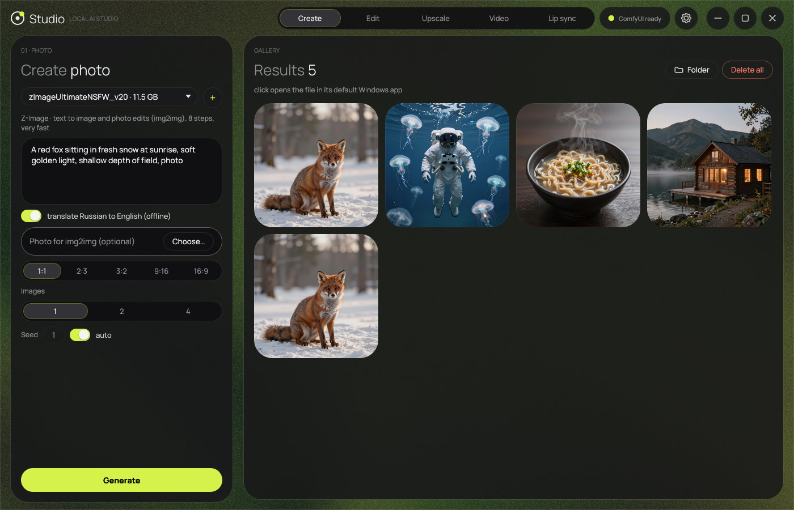
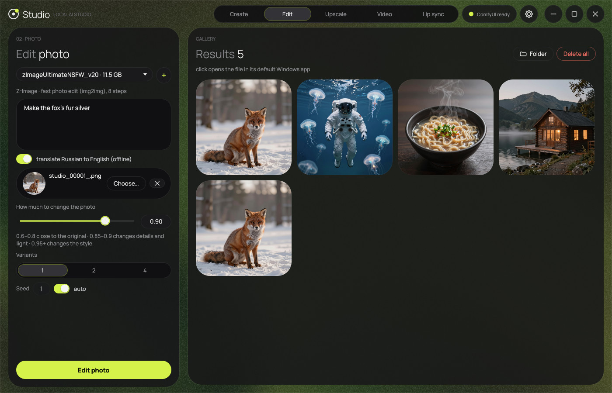
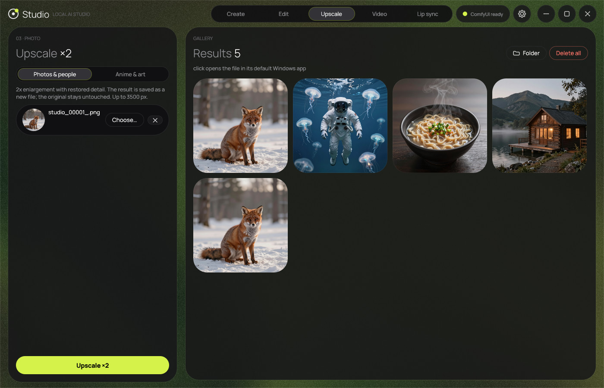
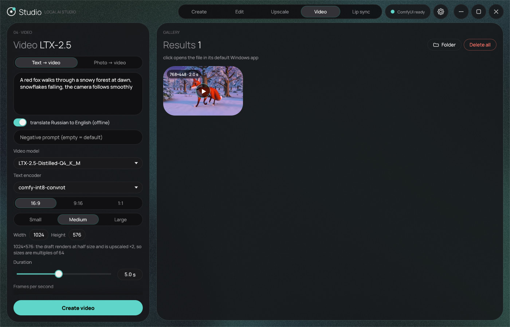
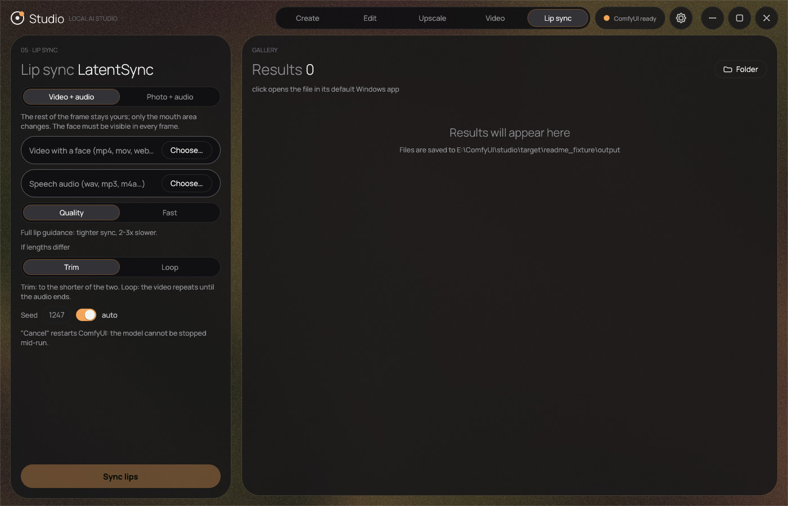
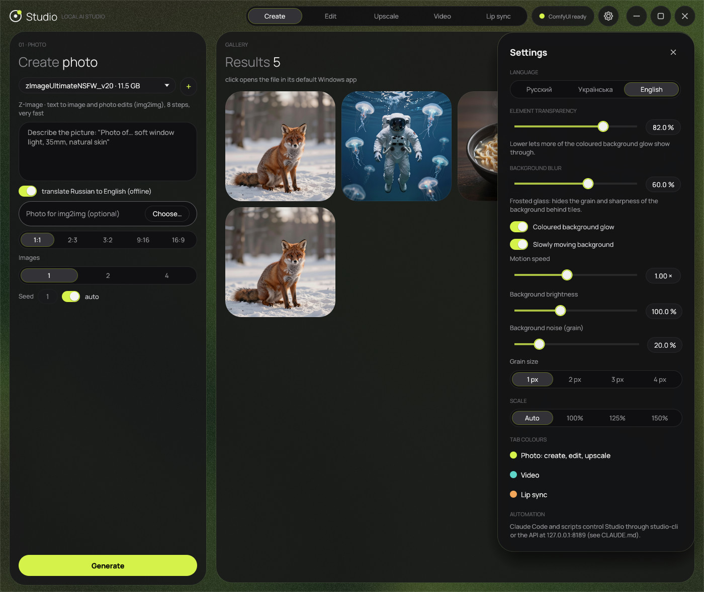

# ✦ Studio AI (ComfyUI Studio)

**English** · [Русский](README.ru.md)

> **A local AI studio for Windows: image generation, photo editing, 2× upscaling, LTX-2.5 video and LatentSync lip sync. A native Rust app on top of ComfyUI, fully offline, no limits.**

[](https://microsoft.com/windows)
[](studio)
[](https://github.com/comfyanonymous/ComfyUI)
[](https://huggingface.co)
[](#-features)

---

## 📸 Screenshots

<table>
  <tr>
    <td width="50%"><br><sub><b>Create</b>: text to image, results in the gallery</sub></td>
    <td width="50%"><br><sub><b>Edit photo</b>: change a photo by instruction</sub></td>
  </tr>
  <tr>
    <td width="50%"><br><sub><b>Upscale ×2</b>: photos, people, objects and anime</sub></td>
    <td width="50%"><br><sub><b>Video</b>: LTX-2.5, text or photo to video with sound</sub></td>
  </tr>
  <tr>
    <td width="50%"><br><sub><b>Lip sync</b>: LatentSync 1.6, photo or video + audio</sub></td>
    <td width="50%"><br><sub><b>Settings</b>: language, glass transparency and blur, animated background</sub></td>
  </tr>
</table>

---

## ✨ Features

### The app
* **Native Rust application** (egui/eframe), not a browser page: one window, no Python in the app itself. Python is only needed by ComfyUI, which Studio starts in the background when a job begins and stops when it is idle (60 s, 5 minutes after video or lip sync) to give the GPU memory back.
* **Three interface languages:** English, Русский, Українська (the first launch follows the Windows language).
* **Accent colour per tab:** photo, video and lip sync each have their own.
* **Settings (⚙):** language, tile transparency, background blur (frosted glass), an animated "aurora" background with adjustable speed, background brightness, noise (film grain) amount and size, interface scale.
* A click on a finished photo or video opens it in the Windows default app. "Delete all" clears the open tab's results (with confirmation).
* **Automation:** the same job queue is available to scripts and Claude Code through `app\studio-cli.exe` and a local API (127.0.0.1 only), see [CLAUDE.md](CLAUDE.md).

### 1. 🎨 Create
* **Z-Image Ultimate NSFW v2.0**: very fast, **8 steps**, photorealistic. **NoctQ V4 int8 (Qwen-Image 2.1)**: detailed, **25 steps**.
* Aspect ratios in one click (`1:1`, `2:3`, `3:2`, `9:16`, `16:9`), 1, 2 or 4 images per run, fixed or random seed.

### 2. 🪄 Edit photo
* Change an existing photo by instruction (*"Make the jacket red. Keep the face and background"*), combine two photos.
* Z-Image (img2img with a strength slider 0.6–1.0) and NoctQ (the Qwen-Image 2.1 editor).

### 3. 🔍 Upscale ×2
* **4xNomos2 hq dat2** for photos, people and objects (no "waxy" skin or fabric), **4xHFA2k** for art and anime.

### 4. 🎬 Video (LTX-2.5)
* Text to video and photo to video, with sound. Model: `LTX-2.5-Distilled-Q4_K_M.gguf` (GGUF, fits 16 GB) with the official int8 Gemma encoder.
* Size is a multiple of 64 (the draft renders at half size, then ×2), up to 1920 px and 10 s. Tested on an RTX 4080 SUPER 16 GB with 32 GB RAM: up to 1920×1088 for 5 s and 1280×704 for 10 s.
* The first generation after ComfyUI starts takes 6–10 minutes (about 30 GB of weights load), the following ones 2–5 minutes.
* Needs [ComfyUI-GGUF](https://github.com/city96/ComfyUI-GGUF) (the installer sets it up and patches it, see `patches/ComfyUI-GGUF-ltx25-gemma4.patch`). The `Lightricks/LTX-2.5` weights are gated: accept the license on Hugging Face and use a read token.

### 5. 👄 Lip sync (LatentSync 1.6)
* **Video + audio:** the same video with the mouth redone for new speech, the rest of the frame stays. **Photo + audio:** a talking photo.
* [LatentSync 1.6](https://github.com/bytedance/LatentSync) (ByteDance, Apache-2.0) through [ComfyUI-LatentSyncWrapper](https://github.com/ShmuelRonen/ComfyUI-LatentSyncWrapper). It is the best open option among those tested; a closed service such as Sync.so cannot be reproduced with open weights.
* Measured with the SyncNet score (higher is better, real videos score about 6–9): "Quality" 6.3, "Fast" 4.5–4.7, no lip sync 1.4. Measured on synthetic faces and a synthetic voice, not on real people.
* Speed on an RTX 4080 SUPER 16 GB: "Quality" about 2 minutes per second of result, "Fast" about 45 s. Results are limited to **60 s**. Video is converted to 25 fps automatically; `ffmpeg` must be on PATH (`winget install Gyan.FFmpeg`).
* One frontal face; cartoon faces are not supported. "Cancel" restarts ComfyUI because the model cannot be interrupted mid-run.
* The installer fetches the node at a tested commit and applies two small fixes for current PyTorch and PyAV (`patches/ComfyUI-LatentSyncWrapper-local.patch`, the patched files are in `patches/LatentSyncWrapper`).

### 6. 🌐 Offline translator RU → EN
* **Helsinki-NLP/opus-mt-ru-en** runs on the **CPU** through [candle](https://github.com/huggingface/candle): no VRAM, no internet. A photography glossary is built in ("depth of field", "bokeh", "golden hour"…). Write prompts in Russian, Studio translates them on the fly.

---

## 🚀 Install

### Option 1: the installer (recommended)
1. Download **`Setup.exe`** from the [latest release](https://github.com/reyjendiz/studio-ai/releases/latest) (or run it from the project folder).
2. Tick the components you want:
   - [x] **Offline translator RU → EN** (~311 MB)
   - [x] **Upscaler ×2 models** (~173 MB)
   - [x] **Z-Image Ultimate NSFW v2.0** (~17 GB)
   - [x] **NoctQ V4 int8, Qwen-Image 2.1** (~16 GB)
   - [ ] **Video LTX-2.5 (GGUF) + ComfyUI-GGUF** (~34 GB, off by default): needs a Hugging Face token, see below
   - [ ] **Lip sync: LatentSync 1.6 + node** (~5.5 GB, off by default): open models, no token; needs `ffmpeg` on PATH
   - [x] **Create a "Studio" shortcut on the Desktop**
3. For video: accept the license of [Lightricks/LTX-2.5](https://huggingface.co/Lightricks/LTX-2.5), create a Read token ([settings](https://huggingface.co/settings/tokens)) and paste it into the installer. The token is not stored and is sent only to huggingface.co.
4. Press **Start installation**. Files come from Hugging Face and Civitai with speed display, resume after failures and size checks. Then press **Launch Studio**.

### Option 2: PowerShell
```powershell
.\install.ps1                          # translator, upscalers, Z-Image, NoctQ
.\install.ps1 -Lipsync                 # + lip sync LatentSync 1.6 (~5.5 GB, no token)
.\install.ps1 -LTX -HfToken hf_xxx     # + video LTX-2.5 (token from -HfToken, $env:HF_TOKEN or the huggingface_hub cache)
```
Or double-click **`install.bat`**. Other switches: `-SkipZImage`, `-SkipNoctQ`, `-SkipUpscalers`, `-SkipTranslator`, `-NoShortcut`.

---

## 🖥️ Run

* **Desktop shortcut** "Студия" (created by the installer), or `app\Studio.exe` directly.
* `start_studio.bat` or `Studio.vbs` (no console window).
* **Automation:** `app\studio-cli.exe`, for example `studio-cli gen --prompt "a red fox in the snow" --out fox.jpg`, see [CLAUDE.md](CLAUDE.md).
* The old WebView2 shell stays as `app\StudioWebView.exe` (needs `ui\server.py`).

---

## 📦 Model layout

| Model / component | Purpose | Folder |
|---|---|---|
| `zImageUltimateNSFW_v20.safetensors` | Z-Image main model | `ComfyUI\models\diffusion_models\` |
| `qwen_3_4b_fp8_mixed.safetensors` | Z-Image text encoder | `ComfyUI\models\text_encoders\` |
| `ae.safetensors` | Z-Image VAE | `ComfyUI\models\vae\` |
| `NoctQ_V4_int8_convrot.safetensors` | NoctQ 2.1 main model | `ComfyUI\models\diffusion_models\` |
| `qwen3vl_8b_int8_convrot.safetensors` | NoctQ text encoder | `ComfyUI\models\text_encoders\` |
| `qwen_image_2.1_vae_bf16.safetensors` | NoctQ VAE | `ComfyUI\models\vae\` |
| `4xNomos2_hq_dat2.safetensors` | Upscaler for photos | `ComfyUI\models\upscale_models\` |
| `4xHFA2k.safetensors` | Upscaler for anime and art | `ComfyUI\models\upscale_models\` |
| `LTX-2.5-Distilled-Q4_K_M.gguf` + encoder, VAEs, latent upscaler | Video | `ComfyUI\models\unet\`, `text_encoders\`, `vae\`, `latent_upscale_models\` |
| `latentsync_unet.pt`, `whisper\tiny.pt`, `vae\` (Stable Diffusion VAE) | Lip sync | `ComfyUI\custom_nodes\ComfyUI-LatentSyncWrapper\checkpoints\` |
| `opus-mt-ru-en` | Local translator | `translate\opus-mt-ru-en\` |

Model family registry: [`ui/models.json`](ui/models.json).

---

## 💻 Requirements

* **OS:** Windows 10 or 11 (64-bit)
* **GPU:** NVIDIA with CUDA. Images run from about 8 GB VRAM (INT8/FP8 weights fit 6 GB); video and lip sync were tested on 16 GB and use it all.
* **RAM:** 16 GB or more (32 GB for the largest videos)
* **Disk:** 35–40 GB for images, about 80 GB with video and lip sync
* **Software:** a current NVIDIA driver; `ffmpeg` on PATH for lip sync

---

## 🛠️ Tech stack

* **App:** Rust, [egui/eframe](https://github.com/emilk/egui), Manrope font (folder `studio/`): window, job queue, ComfyUI control, local API and `studio-cli`
* **Translator:** Helsinki-NLP/opus-mt-ru-en on the CPU via candle, no Python
* **Engine:** [ComfyUI](https://github.com/comfyanonymous/ComfyUI) (Portable build)
* **Installer:** a standalone C# GUI wizard (`Setup.exe`), no dependencies

---

## 🧩 Development

The project sits on top of a **ComfyUI Portable** build: `ComfyUI\` and `python_embeded\` must be next to the repository files (they are not in the repository).

1. `git clone https://github.com/reyjendiz/studio-ai.git`
2. Put `ComfyUI\` and `python_embeded\` from [ComfyUI Portable](https://github.com/comfyanonymous/ComfyUI/releases) into the project folder.
3. Apply the ComfyUI fix (cuDNN conv3d workaround): `git -C ComfyUI apply ..\patches\comfyui-cudnn-conv3d.patch`
4. Install models with `Setup.exe` or `install.ps1`.
5. Build and run: `studio\build.bat` (needs Rust), then `app\Studio.exe`. Tests: `cd studio && cargo test --release`. Screenshots of every tab: `cargo test --release --test layout -- --ignored` writes to `logs\ui\`.

| What to change | Where |
|---|---|
| Window, tabs, theme, languages, background | [`studio/src/ui/`](studio/src/ui) (`i18n_table.rs`: translations, a test checks that every string is translated; `aurora.rs`: animated background) |
| ComfyUI graphs | [`studio/src/workflows.rs`](studio/src/workflows.rs), video and lip-sync templates in `ui/ltx` and `ui/lipsync` |
| Job queue, ComfyUI control, API, CLI | `studio/src/jobs.rs`, `engine.rs`, `api.rs`, `bin/cli.rs` |
| Icon and fonts | `studio/tools/make_icon.py`, `studio/tools/make_fonts.py`, `ui/studio.ico`, `ui/studio.png` |
| Old interface (HTML + Python), not needed by the new app | `ui/index.html`, `ui/server.py`, `app/Studio.cs` |
| Installer | [`installer/Setup.cs`](installer/Setup.cs), build with `installer\build.bat` (writes `Setup.exe` to the root) |

A release is made like this: build `Setup.exe`, commit, then `gh release create vX.Y.Z .\Setup.exe`.

---

## 📄 License

Free for personal use. Model weights fall under the licenses of their authors on Civitai and Hugging Face.
