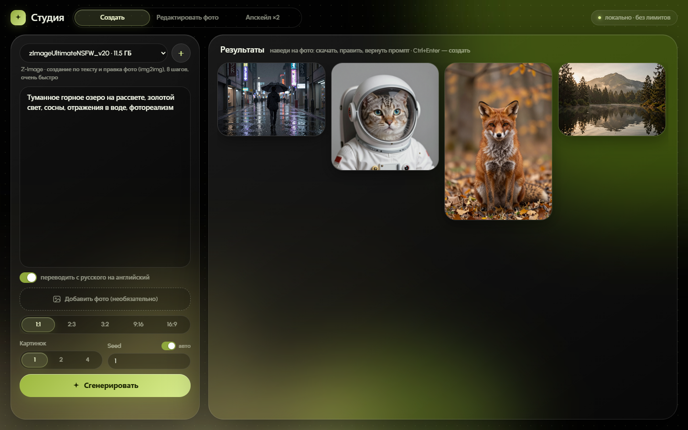
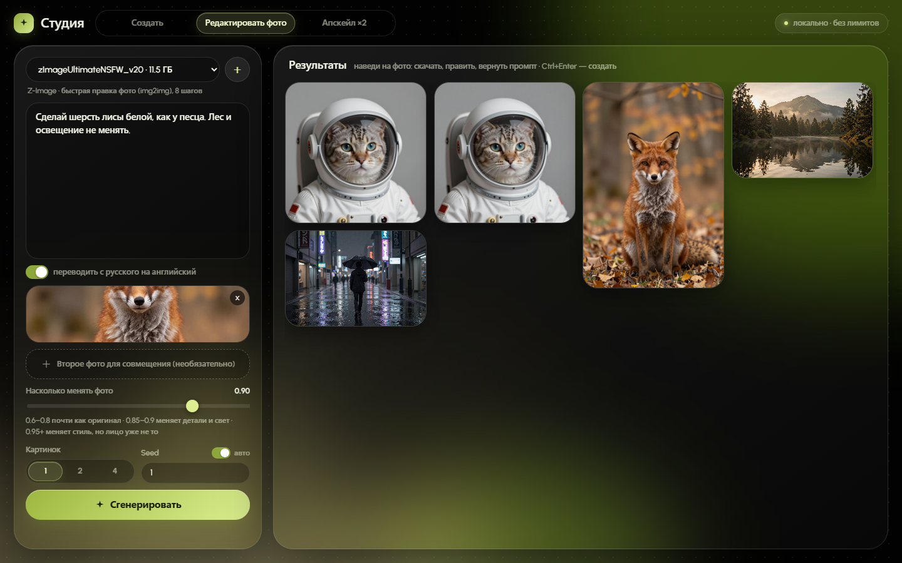
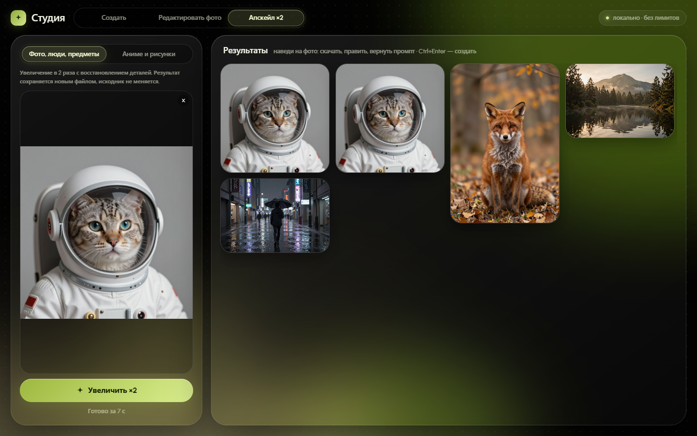
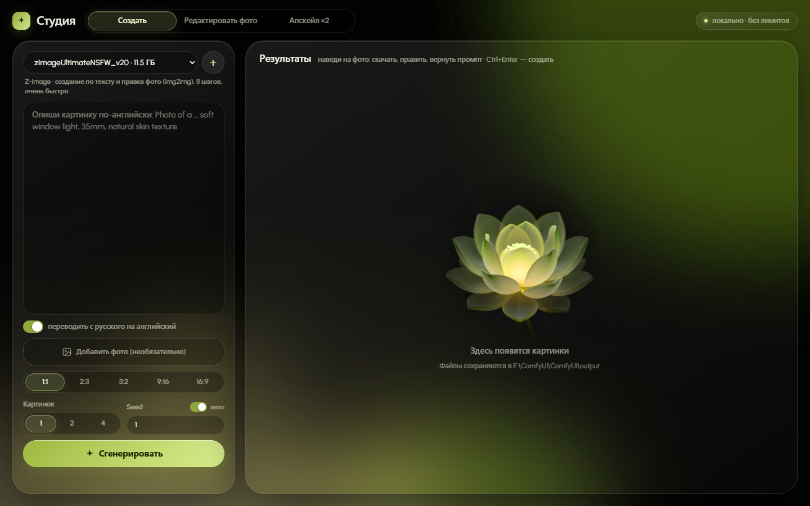

# ✦ Студия AI (ComfyUI Studio)

> **Минималистичная и сверхбыстрая локальная AI-студия: генерация изображений, умная правка фото, апскейл ×2 и встроенный офлайн-переводчик промптов.**

[](https://microsoft.com/windows)
[](https://github.com/comfyanonymous/ComfyUI)
[](https://civitai.com)
[](https://huggingface.co/Helsinki-NLP/opus-mt-ru-en)

---

## 📸 Скриншоты

<table>
  <tr>
    <td width="50%"><br><sub><b>Создать</b>: генерация по тексту, результаты в галерее</sub></td>
    <td width="50%"><br><sub><b>Редактировать фото</b>: правка по инструкции, два фото для совмещения</sub></td>
  </tr>
  <tr>
    <td width="50%"><br><sub><b>Апскейл ×2</b>: фото, люди, предметы и аниме</sub></td>
    <td width="50%"><br><sub>Главный экран: всё помещается на одном экране</sub></td>
  </tr>
</table>

---

## ✨ Возможности

### 1. 🎨 Создание изображений («Создать»)
* **Z-Image Ultimate NSFW v2.0** — сверхбыстрая генерация за **8 шагов**, потрясающий фотореализм, поддержка любых промптов.
* **NoctQ V4 int8 (Qwen-Image 2.1)** — детальная генерация за **25 шагов**, высокая точность понимания анатомии, света и текстур.
* Выбор пропорций в 1 клик: `1:1`, `2:3`, `3:2`, `9:16`, `16:9`.
* Пакетная генерация: 1, 2 или 4 изображения сразу.
* Управление сидом (случайный или фиксированный).

### 2. 🪄 Умное редактирование («Редактировать фото»)
* Редактирование существующих фотографий по текстовой инструкции (например, *"Замени куртку на красную. Лицо и фон не меняй"*).
* Совмещение двух фото (перенос стиля, одежды, окружения).
* Поддержка Z-Image (img2img с ползунком силы изменений 0.6–1.0) и NoctQ (нейросетевой эдитор Qwen-Image 2.1).

### 3. 🔍 Сверхчеткий апскейл («Апскейл ×2»)
* **4xNomos2 hq dat2** — для фото, людей и предметов: чёткий результат без «мыла» на коже и ткани.
* **4xHFA2k** — для артов, рисунков и аниме.
* Увеличение разрешения с удалением артефактов и шумоподавлением.

### 4. 🌐 Встроенный офлайн-переводчик RU → EN
* Модель **Helsinki-NLP/opus-mt-ru-en** работает полностью **локально на CPU** — не расходует драгоценную видеопамять (VRAM) и не требует интернета.
* Встроенный специализированный фотографический глоссарий (*«глубина резкости»*, *«боке»*, *«золотой час»*, *«пленочное зерно»* и др.).
* Пишите промпты на русском языке — студия переведет их на лету.

### 5. ⚡ Умное энергопотребление и освобождение памяти
* ComfyUI запускается в фоне только в момент начала генерации.
* При бездействии более 60 секунд сервер автоматически выгружает веса из VRAM и останавливает ComfyUI, возвращая память другим играм и приложениям.

### 6. 🎬 Видео (LTX-2.5), вкладка «Видео (LTX-2.5)»
* Текст → видео и фото → видео, со звуком. Модель: `LTX-2.5-Distilled-Q4_K_M.gguf` (GGUF, влезает в 16 ГБ) и официальный энкодер `gemma4-12b-with-proj-ltx-2.5-comfy-int8-convrot.safetensors`.
* Размер кратен 64 (черновик считается вдвое меньше, потом ×2), до 1920 px и до 10 с. Проверено на RTX 4080 SUPER 16 ГБ и 32 ГБ ОЗУ: до 1920×1088 на 5 с и 1280×704 на 10 с без нехватки памяти.
* Первая генерация после запуска ComfyUI идёт 6-10 минут (загрузка ~30 ГБ весов), следующие 2-5 минут. После видео ComfyUI остаётся в памяти 5 минут.
* Код: `ui/ltx/` (вкладка и шаблоны графа ComfyUI). Настройки каждого видео лежат рядом с ним: `ComfyUI\output\video\*.json`. Графы для окна ComfyUI: `ComfyUI\user\default\workflows\LTX-2.5 *.json`.
* Нужен узел [ComfyUI-GGUF](https://github.com/city96/ComfyUI-GGUF) в `ComfyUI\custom_nodes`; к нему применён патч `patches/ComfyUI-GGUF-ltx25-gemma4.patch` (`git apply`).
* Веса `Lightricks/LTX-2.5` закрыты лицензией на Hugging Face: нужно принять условия и войти (`huggingface_hub.interpreter_login()`).

---

## 🚀 Быстрый старт и установка

### Способ 1: Готовый EXE-установщик (Рекомендуется)
1. Скачайте проект или запустите файл **`Setup.exe`** из корня папки.
2. Откроется графический мастер установки.
3. Отметьте нужные модели и компоненты галочками:
   - [x] **Офлайн-переводчик RU → EN** (~311 МБ)
   - [x] **Модели Апскейлера ×2** (~173 МБ)
   - [x] **Z-Image Ultimate NSFW v2.0** (~17.0 ГБ)
   - [x] **NoctQ V4 int8 Qwen-Image 2.1** (~16.1 ГБ)
   - [ ] **Видео LTX-2.5 (GGUF) + ComfyUI-GGUF** (~34 ГБ, по умолчанию не отмечено): нужен токен Hugging Face, см. ниже
   - [x] **Создать ярлык «Студия» на Рабочем столе**
4. Для видео: примите лицензию на [Lightricks/LTX-2.5](https://huggingface.co/Lightricks/LTX-2.5), создайте токен с правом Read ([настройки](https://huggingface.co/settings/tokens)) и вставьте его в поле установщика. Токен нигде не сохраняется и отправляется только на huggingface.co. Установщик также скачает [ComfyUI-GGUF](https://github.com/city96/ComfyUI-GGUF) нужной версии, применит патч и поставит его Python-зависимости.
5. Нажмите кнопку **«Начать установку»**.
6. Установщик автоматически скачает файлы с Hugging Face и Civitai с отображением скорости, докачкой при сбоях и проверкой размера файлов.
7. По завершении нажмите кнопку **«Запустить Студию»**!

### Способ 2: Установка через PowerShell / Командную строку
Если вы предпочитаете консоль или запускаете на сервере:
```powershell
# Запуск автоматического скрипта установки
.\install.ps1
# вместе с видео LTX-2.5 (токен берётся из -HfToken, $env:HF_TOKEN или кэша huggingface_hub)
.\install.ps1 -LTX -HfToken hf_xxx
```
Или двойной клик по **`install.bat`**.

---

## 🖥️ Запуск приложения

После установки запускать Студию можно любым удобным способом:
* **Ярлык на Рабочем столе:** `Студия` (создается установщиком)
* **Нативное приложение:** `app\Studio.exe` (WebView2, без рамок браузера)
* **Быстрый скрипт:** `Studio.ps1` (запуск в чистом окне Microsoft Edge App)
* **Пакетный файл:** `start_studio.bat`

---

## 📦 Структура моделей в проекте

Если вы хотите вручную добавить или переместить файлы:

| Модель / Компонент | Назначение | Папка размещения |
|---|---|---|
| `zImageUltimateNSFW_v20.safetensors` | Основная модель Z-Image | `ComfyUI\models\diffusion_models\` |
| `qwen_3_4b_fp8_mixed.safetensors` | Текстовый энкодер Z-Image | `ComfyUI\models\text_encoders\` |
| `ae.safetensors` | VAE автоэнкодер Z-Image | `ComfyUI\models\vae\` |
| `NoctQ_V4_int8_convrot.safetensors` | Основная модель NoctQ 2.1 | `ComfyUI\models\diffusion_models\` |
| `qwen3vl_8b_int8_convrot.safetensors` | Текстовый энкодер NoctQ | `ComfyUI\models\text_encoders\` |
| `qwen_image_2.1_vae_bf16.safetensors`| VAE автоэнкодер NoctQ | `ComfyUI\models\vae\` |
| `4xNomos2_hq_dat2.safetensors` | Апскейлер для фото, людей и предметов | `ComfyUI\models\upscale_models\` |
| `4xHFA2k.safetensors` | Апскейлер для аниме/арта | `ComfyUI\models\upscale_models\` |
| `opus-mt-ru-en` (веса и токенизатор)| Локальный переводчик | `translate\opus-mt-ru-en\` |

Файл регистрации семейств моделей: [`ui/models.json`](ui/models.json).

---

## 💻 Системные требования

* **ОС:** Windows 10 или Windows 11 (64-bit)
* **Видеокарта:** NVIDIA GeForce с поддержкой CUDA (рекомендуется от 8 ГБ VRAM; работает от 6 ГБ благодаря квантованию INT8/FP8)
* **Оперативная память (RAM):** от 16 ГБ
* **Место на диске:** от 35–40 ГБ свободного места на SSD (для весов нейросетей)
* **Драйверы:** NVIDIA Game Ready / Studio Driver актуальной версии

---

## 🛠️ Стек технологий

* **Интерфейс:** Vanilla HTML5, CSS3 (Apple Design System, responsive, dark theme), JavaScript ES6+
* **Бэкенд интерфейса:** Python `http.server` с пулом потоков, проксированием ComfyUI API и управлением жизненным циклом процессов (`ui/server.py`)
* **AI Движок:** [ComfyUI](https://github.com/comfyanonymous/ComfyUI) (автономная сборка Portable)
* **Нативная оболочка:** C# / .NET Windows Forms + Microsoft Edge WebView2 (`app/Studio.exe`)
* **Установщик:** Автономный C# GUI мастер установки (`Setup.exe`) без внешних зависимостей

---

## 🧩 Разработка: как доработать проект

Проект лежит поверх сборки **ComfyUI Portable**: рядом с файлами репозитория должны быть папки `ComfyUI\` и `python_embeded\` (в репозиторий они не входят).

1. Клонируйте репозиторий: `git clone https://github.com/reyjendiz/studio-ai.git`
2. Положите в папку проекта `ComfyUI\` и `python_embeded\` из [ComfyUI Portable](https://github.com/comfyanonymous/ComfyUI/releases).
3. Примените правку ComfyUI (обход проблемы cuDNN conv3d): `git -C ComfyUI apply ..\patches\comfyui-cudnn-conv3d.patch`
4. Поставьте модели через `Setup.exe` или `install.ps1`.
5. Запуск из исходников: `python_embeded\python.exe ui\server.py`, затем откройте <http://127.0.0.1:8189>.

| Что менять | Где |
|---|---|
| Интерфейс (вёрстка, стили, режимы, графы ComfyUI) | [`ui/index.html`](ui/index.html), один файл; после правки достаточно обновить страницу |
| Сервер интерфейса (прокси ComfyUI, модели, перевод, запуск и остановка ComfyUI) | [`ui/server.py`](ui/server.py), нужен перезапуск сервера |
| Иллюстрации и иконка | `ui/art\`, `ui/studio.ico`, `ui/studio.png` |
| Окно приложения (C#, WebView2) | [`app/Studio.cs`](app/Studio.cs), сборка: `app\build.bat` |
| Установщик | [`installer/Setup.cs`](installer/Setup.cs), сборка: `installer\build.bat` (создаёт `Setup.exe` в корне) |

Новая версия выпускается так: соберите `Setup.exe`, закоммитьте изменения и создайте релиз командой `gh release create vX.Y.Z .\Setup.exe`.

---

## 📄 Лицензия

Распространяется свободно для личного использования. Веса моделей подпадают под лицензии соответствующих авторов на Civitai и Hugging Face.
