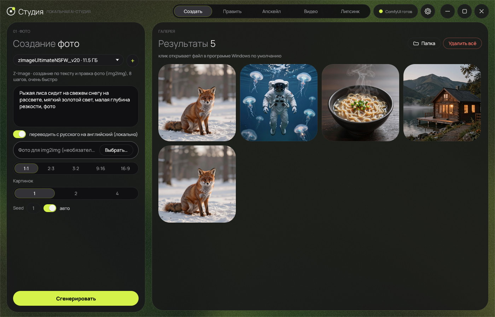
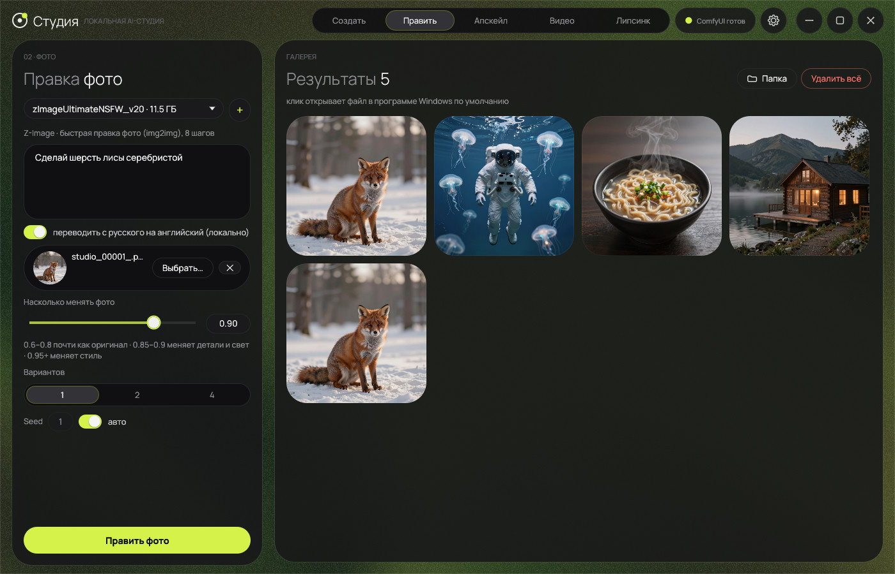
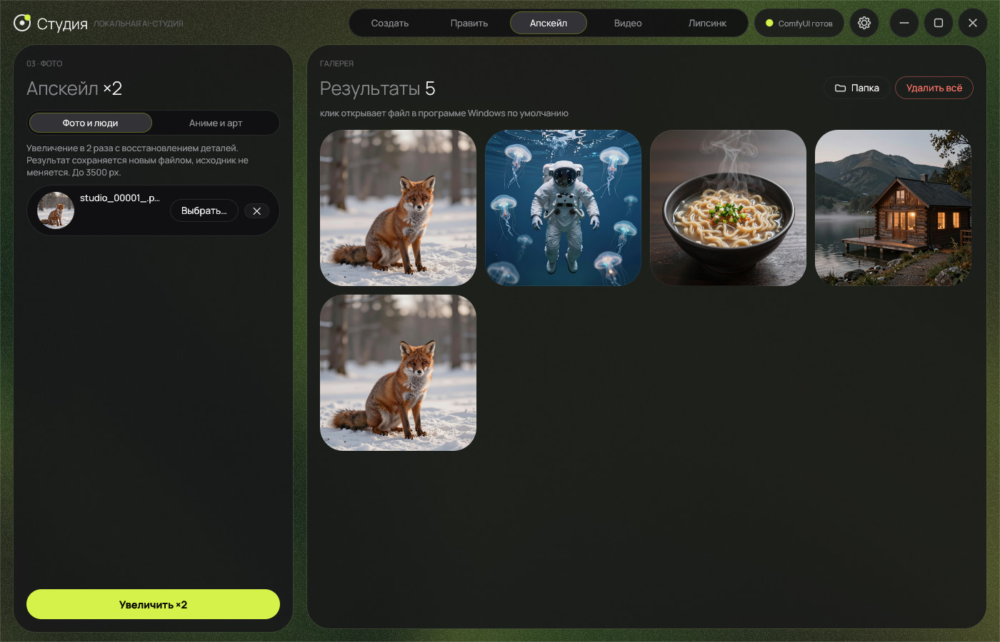
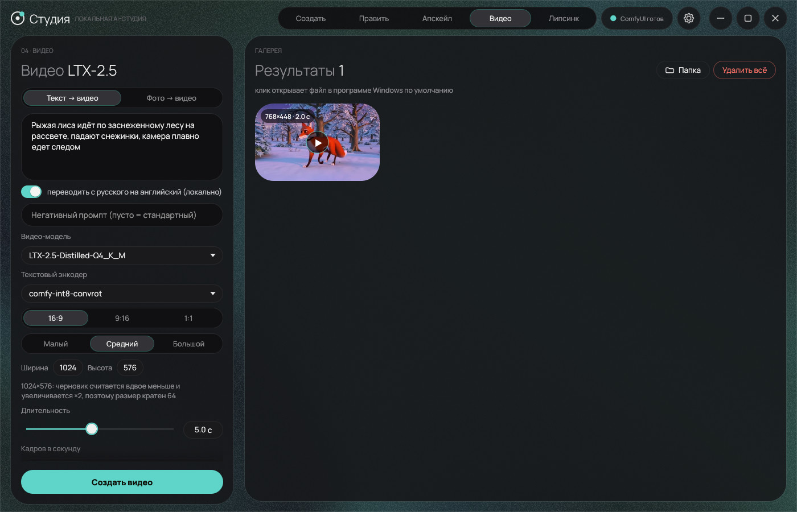
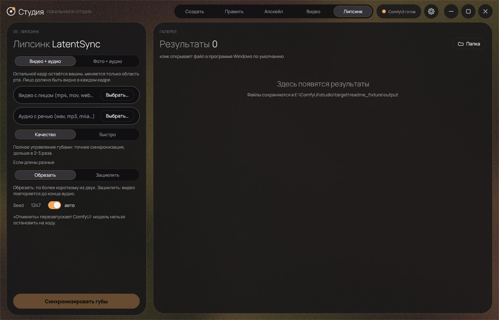
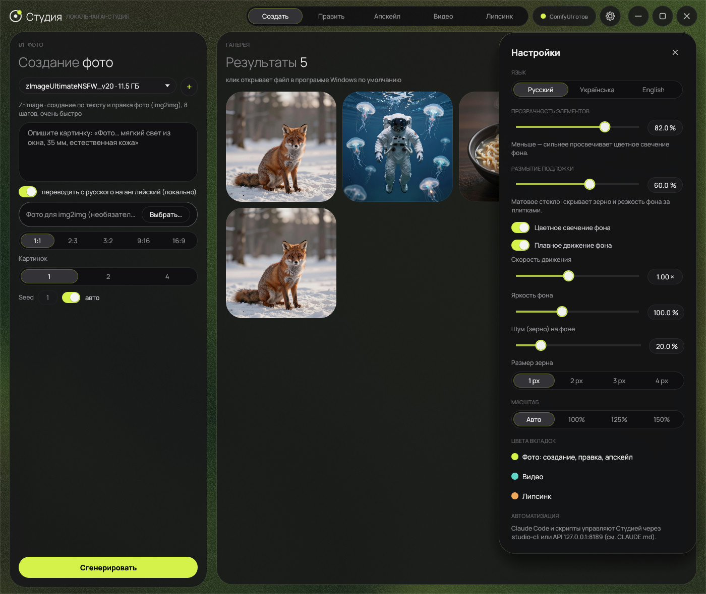

# ✦ Студия AI (ComfyUI Studio)

[English](README.md) · **Русский**

> **Локальная AI-студия для Windows: генерация изображений, правка фото, апскейл ×2, видео LTX-2.5 и липсинк LatentSync. Нативное приложение на Rust поверх ComfyUI, полностью офлайн и без лимитов.**

[](https://microsoft.com/windows)
[](studio)
[](https://github.com/comfyanonymous/ComfyUI)
[](https://huggingface.co)
[](#-возможности)

---

## 📸 Скриншоты

<table>
  <tr>
    <td width="50%"><br><sub><b>Создать</b>: генерация по тексту, результаты в галерее</sub></td>
    <td width="50%"><br><sub><b>Править фото</b>: изменение фото по инструкции</sub></td>
  </tr>
  <tr>
    <td width="50%"><br><sub><b>Апскейл ×2</b>: фото, люди, предметы и аниме</sub></td>
    <td width="50%"><br><sub><b>Видео</b>: LTX-2.5, текст или фото в видео со звуком</sub></td>
  </tr>
  <tr>
    <td width="50%"><br><sub><b>Липсинк</b>: LatentSync 1.6, фото или видео + аудио</sub></td>
    <td width="50%"><br><sub><b>Настройки</b>: язык, прозрачность и размытие плиток, живой фон</sub></td>
  </tr>
</table>

---

## ✨ Возможности

### Приложение
* **Нативное приложение на Rust** (egui/eframe), а не страница в браузере: одно окно, в самом приложении нет Python. Python нужен только ComfyUI: Студия запускает его в фоне, когда начинается задача, и останавливает при простое (60 с, 5 минут после видео и липсинка), возвращая видеопамять.
* **Три языка интерфейса:** English, Русский, Українська (при первом запуске берётся язык Windows).
* **Свой цвет акцента у каждой вкладки:** фото, видео и липсинк.
* **Настройки (⚙):** язык, прозрачность плиток, размытие подложки (матовое стекло), живой фон «аврора» с настраиваемой скоростью, яркость фона, шум (зерно) с настройкой количества и размера, масштаб интерфейса.
* Клик по готовому фото или видео открывает файл в программе Windows по умолчанию. «Удалить всё» стирает результаты открытой вкладки (с подтверждением).
* **Автоматизация:** та же очередь задач доступна скриптам и Claude Code через `app\studio-cli.exe` и локальный API (только 127.0.0.1), см. [CLAUDE.md](CLAUDE.md).

### 1. 🎨 Создать
* **Z-Image Ultimate NSFW v2.0**: сверхбыстрая генерация за **8 шагов**, фотореализм. **NoctQ V4 int8 (Qwen-Image 2.1)**: детальная генерация за **25 шагов**.
* Пропорции в 1 клик (`1:1`, `2:3`, `3:2`, `9:16`, `16:9`), 1, 2 или 4 изображения за раз, фиксированный или случайный сид.

### 2. 🪄 Править фото
* Изменение готовой фотографии по инструкции (*«Замени куртку на красную. Лицо и фон не меняй»*), совмещение двух фото.
* Z-Image (img2img с ползунком силы 0.6–1.0) и NoctQ (редактор Qwen-Image 2.1).

### 3. 🔍 Апскейл ×2
* **4xNomos2 hq dat2** для фото, людей и предметов (без «мыла» на коже и ткани), **4xHFA2k** для артов и аниме.

### 4. 🎬 Видео (LTX-2.5)
* Текст → видео и фото → видео, со звуком. Модель `LTX-2.5-Distilled-Q4_K_M.gguf` (GGUF, влезает в 16 ГБ) и официальный энкодер Gemma int8.
* Размер кратен 64 (черновик считается вдвое меньше, потом ×2), до 1920 px и до 10 с. Проверено на RTX 4080 SUPER 16 ГБ и 32 ГБ ОЗУ: до 1920×1088 на 5 с и 1280×704 на 10 с.
* Первая генерация после запуска ComfyUI идёт 6-10 минут (загрузка ~30 ГБ весов), следующие 2-5 минут.
* Нужен [ComfyUI-GGUF](https://github.com/city96/ComfyUI-GGUF) (установщик ставит его и патчит, см. `patches/ComfyUI-GGUF-ltx25-gemma4.patch`). Веса `Lightricks/LTX-2.5` закрыты лицензией на Hugging Face: примите условия и используйте токен с правом Read.

### 5. 👄 Липсинк (LatentSync 1.6)
* **Видео + аудио:** то же видео с губами под новую речь, остальной кадр не трогается. **Фото + аудио:** говорящее фото.
* [LatentSync 1.6](https://github.com/bytedance/LatentSync) (ByteDance, Apache-2.0) через узел [ComfyUI-LatentSyncWrapper](https://github.com/ShmuelRonen/ComfyUI-LatentSyncWrapper). Это лучший открытый вариант из проверенных; закрытый сервис вроде Sync.so открытыми весами не воспроизвести.
* Проверено SyncNet-оценкой (выше лучше, у настоящих видео около 6-9): «Качество» 6.3, «Быстро» 4.5-4.7, без липсинка 1.4. Измерено на синтетических лицах и синтетическом голосе, на реальных людях не проверялось.
* Скорость на RTX 4080 SUPER 16 ГБ: «Качество» ≈ 2 мин на секунду результата, «Быстро» ≈ 45 с. Результат ограничен **60 с**. Видео переводится в 25 к/с автоматически, нужен `ffmpeg` в PATH (`winget install Gyan.FFmpeg`).
* Работает с одним лицом анфас, мультяшные лица не поддерживаются. «Отменить» перезапускает ComfyUI: модель нельзя остановить на ходу.
* Установщик скачивает узел нужной версии и применяет две небольшие правки под актуальные PyTorch и PyAV (`patches/ComfyUI-LatentSyncWrapper-local.patch`, исправленные файлы лежат в `patches/LatentSyncWrapper`).

### 6. 🌐 Офлайн-переводчик RU → EN
* **Helsinki-NLP/opus-mt-ru-en** работает на **CPU** через [candle](https://github.com/huggingface/candle): без видеопамяти и без интернета. Встроен фотографический глоссарий («глубина резкости», «боке», «золотой час»…). Пишите промпты по-русски, Студия переведёт их на лету.

---

## 🚀 Установка

### Способ 1: EXE-установщик (рекомендуется)
1. Скачайте **`Setup.exe`** из [последнего релиза](https://github.com/reyjendiz/studio-ai/releases/latest) (или запустите его из папки проекта).
2. Отметьте нужные компоненты:
   - [x] **Офлайн-переводчик RU → EN** (~311 МБ)
   - [x] **Модели апскейлера ×2** (~173 МБ)
   - [x] **Z-Image Ultimate NSFW v2.0** (~17 ГБ)
   - [x] **NoctQ V4 int8, Qwen-Image 2.1** (~16 ГБ)
   - [ ] **Видео LTX-2.5 (GGUF) + ComfyUI-GGUF** (~34 ГБ, по умолчанию не отмечено): нужен токен Hugging Face, см. ниже
   - [ ] **Липсинк: LatentSync 1.6 + узел** (~5.5 ГБ, по умолчанию не отмечено): открытые модели, токен не нужен; нужен `ffmpeg` в PATH
   - [x] **Создать ярлык «Студия» на Рабочем столе**
3. Для видео: примите лицензию [Lightricks/LTX-2.5](https://huggingface.co/Lightricks/LTX-2.5), создайте токен с правом Read ([настройки](https://huggingface.co/settings/tokens)) и вставьте его в установщик. Токен нигде не сохраняется и отправляется только на huggingface.co.
4. Нажмите **«Начать установку»**. Файлы скачиваются с Hugging Face и Civitai с показом скорости, докачкой при сбоях и проверкой размера. Затем нажмите **«Запустить Студию»**.

### Способ 2: PowerShell
```powershell
.\install.ps1                          # переводчик, апскейлеры, Z-Image, NoctQ
.\install.ps1 -Lipsync                 # + липсинк LatentSync 1.6 (~5.5 ГБ, без токена)
.\install.ps1 -LTX -HfToken hf_xxx     # + видео LTX-2.5 (токен из -HfToken, $env:HF_TOKEN или кэша huggingface_hub)
```
Или двойной клик по **`install.bat`**. Другие ключи: `-SkipZImage`, `-SkipNoctQ`, `-SkipUpscalers`, `-SkipTranslator`, `-NoShortcut`.

---

## 🖥️ Запуск

* **Ярлык «Студия»** на Рабочем столе (создаёт установщик) или сразу `app\Studio.exe`.
* `start_studio.bat` или `Studio.vbs` (без чёрного окна).
* **Автоматизация:** `app\studio-cli.exe`, например `studio-cli gen --prompt "рыжая лиса на снегу" --out fox.jpg`, см. [CLAUDE.md](CLAUDE.md).
* Старая оболочка на WebView2 осталась как `app\StudioWebView.exe` (нужен `ui\server.py`).

---

## 📦 Структура моделей

| Модель / компонент | Назначение | Папка |
|---|---|---|
| `zImageUltimateNSFW_v20.safetensors` | Основная модель Z-Image | `ComfyUI\models\diffusion_models\` |
| `qwen_3_4b_fp8_mixed.safetensors` | Текстовый энкодер Z-Image | `ComfyUI\models\text_encoders\` |
| `ae.safetensors` | VAE Z-Image | `ComfyUI\models\vae\` |
| `NoctQ_V4_int8_convrot.safetensors` | Основная модель NoctQ 2.1 | `ComfyUI\models\diffusion_models\` |
| `qwen3vl_8b_int8_convrot.safetensors` | Текстовый энкодер NoctQ | `ComfyUI\models\text_encoders\` |
| `qwen_image_2.1_vae_bf16.safetensors` | VAE NoctQ | `ComfyUI\models\vae\` |
| `4xNomos2_hq_dat2.safetensors` | Апскейлер для фото | `ComfyUI\models\upscale_models\` |
| `4xHFA2k.safetensors` | Апскейлер для аниме и арта | `ComfyUI\models\upscale_models\` |
| `LTX-2.5-Distilled-Q4_K_M.gguf` + энкодер, VAE, апскейлер латентов | Видео | `ComfyUI\models\unet\`, `text_encoders\`, `vae\`, `latent_upscale_models\` |
| `latentsync_unet.pt`, `whisper\tiny.pt`, `vae\` (Stable Diffusion VAE) | Липсинк | `ComfyUI\custom_nodes\ComfyUI-LatentSyncWrapper\checkpoints\` |
| `opus-mt-ru-en` | Локальный переводчик | `translate\opus-mt-ru-en\` |

Реестр семейств моделей: [`ui/models.json`](ui/models.json).

---

## 💻 Системные требования

* **ОС:** Windows 10 или 11 (64-bit)
* **Видеокарта:** NVIDIA с CUDA. Изображения работают от 8 ГБ видеопамяти (веса INT8/FP8 помещаются и в 6 ГБ); видео и липсинк проверены на 16 ГБ и занимают её целиком.
* **Оперативная память:** от 16 ГБ (32 ГБ для самых больших видео)
* **Диск:** 35-40 ГБ для изображений, около 80 ГБ вместе с видео и липсинком
* **ПО:** актуальный драйвер NVIDIA; для липсинка `ffmpeg` в PATH

---

## 🛠️ Стек

* **Приложение:** Rust, [egui/eframe](https://github.com/emilk/egui), шрифт Manrope (папка `studio/`): окно, очередь задач, управление ComfyUI, локальный API и `studio-cli`
* **Переводчик:** Helsinki-NLP/opus-mt-ru-en на CPU через candle, без Python
* **Движок:** [ComfyUI](https://github.com/comfyanonymous/ComfyUI) (сборка Portable)
* **Установщик:** автономный GUI-мастер на C# (`Setup.exe`), без зависимостей

---

## 🧩 Разработка

Проект лежит поверх сборки **ComfyUI Portable**: рядом с файлами репозитория должны быть папки `ComfyUI\` и `python_embeded\` (в репозиторий они не входят).

1. `git clone https://github.com/reyjendiz/studio-ai.git`
2. Положите в папку проекта `ComfyUI\` и `python_embeded\` из [ComfyUI Portable](https://github.com/comfyanonymous/ComfyUI/releases).
3. Примените правку ComfyUI (обход проблемы cuDNN conv3d): `git -C ComfyUI apply ..\patches\comfyui-cudnn-conv3d.patch`
4. Поставьте модели через `Setup.exe` или `install.ps1`.
5. Сборка и запуск: `studio\build.bat` (нужен Rust), затем `app\Studio.exe`. Тесты: `cd studio && cargo test --release`. Скриншоты всех вкладок: `cargo test --release --test layout -- --ignored` пишет в `logs\ui\`.

| Что менять | Где |
|---|---|
| Окно, вкладки, тема, языки, фон | [`studio/src/ui/`](studio/src/ui) (`i18n_table.rs`: переводы, тест проверяет, что все строки переведены; `aurora.rs`: живой фон) |
| Графы ComfyUI | [`studio/src/workflows.rs`](studio/src/workflows.rs), шаблоны видео и липсинка в `ui/ltx` и `ui/lipsync` |
| Очередь задач, управление ComfyUI, API, CLI | `studio/src/jobs.rs`, `engine.rs`, `api.rs`, `bin/cli.rs` |
| Иконка и шрифты | `studio/tools/make_icon.py`, `studio/tools/make_fonts.py`, `ui/studio.ico`, `ui/studio.png` |
| Старый интерфейс (HTML + Python), новому приложению не нужен | `ui/index.html`, `ui/server.py`, `app/Studio.cs` |
| Установщик | [`installer/Setup.cs`](installer/Setup.cs), сборка: `installer\build.bat` (создаёт `Setup.exe` в корне) |

Релиз выпускается так: соберите `Setup.exe`, закоммитьте изменения и выполните `gh release create vX.Y.Z .\Setup.exe`.

---

## 📄 Лицензия

Распространяется свободно для личного использования. Веса моделей подпадают под лицензии соответствующих авторов на Civitai и Hugging Face.
